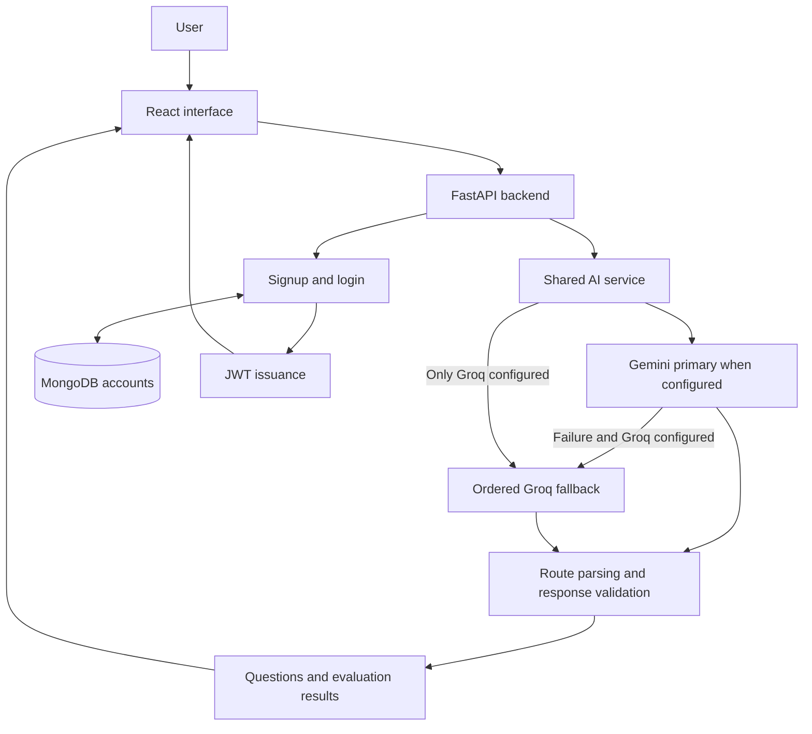

<div align="center">

# 🎯 Mock Interview AI

### Your AI-Powered Interview Preparation Companion

**Practice smarter. Interview better. Get career-ready.**

Prepare for technical interviews with configurable mock tests, role-specific questions, and AI feedback on your answers.


**[Open Live Demo](https://mock-interview-king-09.vercel.app/)** · **[GitHub Repository](https://github.com/Priyanshuraj0909/Mock-Interview)**

[Mock Tests](https://mock-interview-king-09.vercel.app/dashboard) · [Interview Studio](https://mock-interview-king-09.vercel.app/dashboardmain) · [Sign Up](https://mock-interview-king-09.vercel.app/signup) · [Sign In](https://mock-interview-king-09.vercel.app/login)

</div>

## Explore

[Overview](#overview) · [Features](#features) · [Screenshots](#screenshots) · [Technology](#technology-stack) · [Architecture](#architecture) · [AI Integration](#ai-integration-and-failover) · [Local Setup](#local-development) · [Configuration](#environment-variables) · [API](#api-reference) · [Testing](#testing-and-quality) · [Deployment](#vercel-deployment) · [Limitations](#limitations-and-future-work)

## Overview

Mock Interview is a full-stack practice platform for students, placement candidates, and developers preparing for technical roles. It brings question generation, timed practice, and answer review into one interface so users can rehearse explanations and identify concepts that need more work.

The React client communicates with a FastAPI backend. Google Gemini or Groq generates questions and evaluates written responses; MongoDB stores accounts. Multiple-choice answers use the supplied answer key, while written and code answers receive meaning-based evaluation and explanations.

## Features

| Area | Implemented behavior |
| --- | --- |
| 📝 Mock tests | Configure purpose, subject, difficulty, test type, and duration; generate a test, navigate questions, and submit when finished or when the timer expires. Generation requests ten questions, though the parser does not enforce exactly ten. |
| 🎙️ Interview studio | Generate role-specific questions with optional job description context and difficulty from 1–5. Supports software engineering, data science, frontend, backend, and full-stack roles. Generation requests five questions. |
| 💬 Answer practice | Type responses or use browser speech recognition where supported; optional speech synthesis reads interview prompts aloud. |
| 🧠 Semantic grading | Evaluate theoretical explanations and code by technical meaning, including paraphrases and equivalent implementations. Return per-question explanations, correct/incorrect counts, and a percentage score. |
| 🔁 AI failover | Use Gemini first when configured, retry temporary failures, and fall back through an ordered Groq model list. |
| 🔐 Accounts | Sign up and log in with MongoDB account storage, bcrypt password hashes, and JWT issuance. |
| 📊 Results | Review answer breakdowns and feedback, then start another test. Retry failed mock-test generation or submission; submission failures preserve answers in the mounted interface. |
| 📱 Interface | Responsive React screens styled with Tailwind CSS, with loading states and request error feedback. |

## Screenshots

Application screenshots have not been verified in the repository. The public directory contains image assets, but they are not presented here as screenshots of the current application.

Use `docs/screenshots/` for future captures. The filenames below are a **proposed convention**, not existing images; no image links are embedded until captures are added.

| Screen | Planned capture | Status |
| --- | --- | --- |
| Landing page | `docs/screenshots/landing.png` | Awaiting capture |
| Mock-test configuration | `docs/screenshots/test-configuration.png` | Awaiting capture |
| Generated questions | `docs/screenshots/questions.png` | Awaiting capture |
| Interview studio | `docs/screenshots/interview-studio.png` | Awaiting capture |
| Assessment results | `docs/screenshots/results.png` | Awaiting capture |
| AI feedback | `docs/screenshots/feedback.png` | Awaiting capture |
| Login and signup | `docs/screenshots/authentication.png` | Awaiting capture |

## Technology Stack

| Layer | Technology | Purpose |
| --- | --- | --- |
| Frontend | React 19, React Router 7 | Interactive practice screens and browser routing |
| Styling and UI | Tailwind CSS 3, Lucide React, Framer Motion | Styling, icons, and animation |
| Client requests | Fetch, Axios | API communication |
| Backend | Python, FastAPI, Pydantic | Async API routes and request/response validation |
| Database | MongoDB, Motor | Account persistence and async database access |
| Primary AI | Google Gemini via `google-genai` | Question generation and answer feedback |
| Fallback AI | Groq Python SDK | Alternative inference with ordered model attempts |
| Authentication | python-jose, Passlib, bcrypt | JWT issuance and password hashing |
| Configuration and TLS | python-dotenv, certifi | Local configuration and trusted CA roots |
| Testing | pytest, HTTPX, Jest, React Testing Library | Backend regressions and frontend retry behavior |
| Build and hosting | Create React App, Vercel | React builds, Python functions, and routing |

## Architecture



The AI service centralizes provider selection and time budgets. Test grading separately validates AI evaluations before calculating scores. Account routes use MongoDB; practice routes currently operate without JWT verification.

## How It Works

1. Open the landing page and choose a mock test or the interview studio.
2. Configure the subject or role, difficulty, and other relevant session options.
3. React sends the configuration to FastAPI, which asks the configured AI provider for questions.
4. Answer the questions using the available text, multiple-choice, or browser voice controls.
5. Submit the test or an individual interview answer for evaluation.
6. Review the resulting score, explanations, strengths, and improvement feedback available in that workflow.

**Mock-test grading:** Multiple-choice answers are compared with the returned answer key after trimming whitespace and normalizing case. Blank answers are incorrect. Nonblank written and code answers are evaluated semantically: the prompt accepts equivalent explanations and valid alternative algorithms while rejecting material conceptual errors. Code is assessed by AI reasoning; it is not executed.

The grader requires one unique evaluation for every expected written answer, with strict boolean verdicts and nonempty explanations. The server derives the percentage and correctness counts from those verdicts. The submission still uses AI for overall feedback even when every question is multiple-choice.

**Interview feedback:** A separate endpoint returns a score, feedback, strength points, and improvement points for each submitted interview answer.

## AI Integration and Failover

The shared service in [`Ai/ai_service.py`](Ai/ai_service.py) is used by both practice workflows.

| Setting | Behavior in this repository |
| --- | --- |
| Primary provider | Gemini when `GEMINI_API_KEY` is present |
| Gemini default | `gemini-3.8-flash`, overridable with `GEMINI_MODEL` |
| Gemini timeout | 15 seconds per SDK request |
| Gemini retry | One retry after one second for HTTP 429, 500, 502, 503, 504 or transport errors; other handled failures proceed to fallback |
| Groq default order | `openai/gpt-oss-20b` → `openai/gpt-oss-120b` → `qwen/qwen3.8-27b` |
| Groq timeout | 10 seconds per model attempt; SDK retries disabled |
| Total time budget | 55 seconds per shared AI generation call |
| Model overrides | `GROQ_MODELS` replaces the order; otherwise `GROQ_MODEL` is tried before defaults. Empty entries and duplicates are removed. |
| Exhausted providers | HTTP 503 with a friendly retry message and `Retry-After: 10` |

Groq advances after handled API errors, transport failures, timeouts, or empty responses. A rejected API key (HTTP 401) stops its model loop. When only Groq is configured, requests go directly to Groq. The total budget can expire before every fallback model is attempted.

These model identifiers are **code defaults**, not a guarantee of current provider availability or account access. Set supported model names for your account before relying on generation. Provider failover handles request failures; malformed grading output is validated separately and returns a retryable error rather than an invented score.

## Local Development

### Prerequisites

- Git and npm.
- Node.js 22 and Python 3.12 as suggested setup targets; this repository does not pin their versions.
- A reachable MongoDB instance for account features.
- At least one AI provider key for question generation and grading.

### 1. Clone the repository

```bash
git clone https://github.com/Priyanshuraj0909/Mock-Interview.git
cd Mock-Interview
```

### 2. Set up the API

From the repository root:

```bash
python3 -m venv .venv
source .venv/bin/activate
pip install -r requirements.txt
cp Ai/.env.example Ai/.env
```

On Windows, activate the environment with `.venv\Scripts\activate` and copy the example using your shell's equivalent command.

Edit `Ai/.env`: configure an AI key, MongoDB connection, and a JWT secret of at least 32 characters. Generate a secret locally with:

```bash
python -c "import secrets; print(secrets.token_urlsafe(48))"
```

Start the API from its directory so dotenv can discover `Ai/.env`:

```bash
cd Ai
uvicorn main:app --reload --port 8000
```

### 3. Set up the client

In another terminal, from the repository root:

```bash
cd newmyapp
npm ci --legacy-peer-deps
cp .env.example .env
npm start
```

The client example sets `REACT_APP_API_BASE_URL=http://localhost:8000/api`. Restart the development server after changing client environment settings.

| Local service | Address |
| --- | --- |
| React application | http://localhost:3000 |
| API health | http://localhost:8000/api/test |
| FastAPI interactive documentation | http://localhost:8000/docs |

The health endpoint confirms API availability; it does not verify AI credentials or database connectivity.

## Environment Variables

Keep server secrets in `Ai/.env` locally and in hosting environment settings in production. Never commit real credentials or put them in React variables.

| Variable | Required for | Default / behavior |
| --- | --- | --- |
| `GEMINI_API_KEY` | AI when using Gemini | At least one of this or `GROQ_API_KEY` is required |
| `GROQ_API_KEY` | Groq inference or fallback | Optional with working Gemini; required for fallback |
| `GEMINI_MODEL` | Optional model selection | `gemini-3.8-flash` |
| `GROQ_MODEL` | Optional preferred Groq model | Prepended to defaults unless `GROQ_MODELS` is set |
| `GROQ_MODELS` | Optional ordered Groq override | Comma-separated model names; see failover section |
| `MONGODB_URI` | Account features | Explicit configuration required; example uses `mongodb://localhost:27017` |
| `MONGO_URL` | Optional database compatibility alias | Used when `MONGODB_URI` is absent |
| `MONGODB_DB` | Optional database selection | `ai_mock_interview` |
| `JWT_SECRET_KEY` | Signup and login | Must contain at least 32 characters |
| `JWT_ALGORITHM` | Optional token algorithm | `HS256` |
| `ACCESS_TOKEN_EXPIRE_MINUTES` | Optional token lifetime | `60` |
| `CORS_ORIGINS` | Optional allowed browser origins | Comma-separated; defaults to `http://localhost:3000` |
| `REACT_APP_API_BASE_URL` | Client API location | Defaults to same-origin `/api`; local example points at port 8000 |

React variables are embedded into the public build. Missing provider configuration returns HTTP 503 for AI operations; missing account configuration returns HTTP 503 for account operations.

## API Reference

| Method | Endpoint | Purpose |
| --- | --- | --- |
| GET | `/` | Backend root message during direct local API access |
| GET | `/api/test` | Basic API health response |
| POST | `/api/auth/signup` | Create an account and issue a JWT |
| POST | `/api/auth/login` | Verify credentials and issue a JWT |
| POST | `/api/generate-test` | Generate mock-test questions |
| POST | `/api/submit-answers` | Grade answers and return scores and explanations |
| POST | `/api/interview/generate-questions` | Generate role-specific interview questions |
| POST | `/api/interview/evaluate-answer` | Return feedback, score, strengths, and improvements |
| GET | `/api/interview/health` | Interview router health response |

In production, `/` serves the React application. The local FastAPI `/docs` interface describes request schemas.

<details>
<summary>Example: generate a mock test</summary>

With a provider configured and the API running:

```bash
curl -X POST http://localhost:8000/api/generate-test \
  -H 'Content-Type: application/json' \
  -d '{"purpose":"Placement preparation","subject":"Python","difficulty":"medium","testType":"conceptual","timeLimit":30}'
```

The response contains a `questions` array. Questions include an `id`, `question`, and `correctAnswer`; multiple-choice questions also include `options`. `timeLimit` must be between 1 and 180 minutes.

</details>

## Testing and Quality

Backend regression tests cover API validation, semantic grading prompts and report handling, score consistency, malformed or duplicate evaluations, provider retries and fallback order, timeouts, and database error responses. Equivalent-answer tests use mocked provider reports; they do not establish real-model grading accuracy.

From the repository root with the virtual environment active:

```bash
pip install pytest httpx
python -m pytest Ai/tests -q
```

Frontend tests cover preserving selected answers after failed submission and retrying failed question generation:

```bash
cd newmyapp
CI=true npm test -- --watchAll=false
CI=true npm run build
```

These are the repository's test and build commands; no coverage percentage or current pass status is claimed here.

## Vercel Deployment

**Live application: [mock-interview-king-09.vercel.app](https://mock-interview-king-09.vercel.app/)**

1. Import the GitHub repository into Vercel with the project root set to the repository root.
2. Configure an AI provider key, `MONGODB_URI`, and `JWT_SECRET_KEY` in the appropriate deployment environments. Configure both provider keys to enable Gemini-to-Groq fallback.
3. Set supported model overrides if the code defaults are unavailable to your provider account.
4. Ensure MongoDB allows connections from the hosting environment, then deploy or redeploy after configuration changes.
5. Check `/api/test`, then verify signup, login, question generation, answer submission, and direct refreshes of `/dashboard` and `/dashboardmain`.

[`vercel.json`](vercel.json) defines the static React build and Python function. The root `vercel-build` script installs client dependencies with `--legacy-peer-deps` and builds `newmyapp/build`. [`api/index.py`](api/index.py) exposes the existing FastAPI app, with `Ai/**` included in the function. `/api` requests go to Python; other paths use filesystem assets or fall back to the React entrypoint for client routing.

The client uses same-origin `/api` by default. Set `REACT_APP_API_BASE_URL` only when a different API origin is needed. Deployment does not provision MongoDB or configure AI access automatically.

<details>
<summary>Troubleshooting MongoDB Atlas</summary>

If account operations return database-unavailable errors, check that the cluster is running, the URI and database credentials are correct, and Atlas Network Access permits the hosting environment's outbound connections. A rule for your laptop alone does not permit Vercel.

URL-encode special characters in database passwords. Redeploy after changing hosting environment variables. The backend uses certifi roots for Atlas and keeps TLS verification enabled; connectivity failures return a friendly HTTP 503 response without driver connection details.

</details>

## Engineering Decisions

| Challenge | Implemented solution | Practical boundary |
| --- | --- | --- |
| AI overload or provider failure | Shared async service with bounded retry, ordered fallback, and a total request budget | Requires valid credentials and accessible models |
| Equivalent written answers | Semantic grading prompt accepts paraphrases and alternative correct implementations | AI judgments can still be wrong; code is not executed |
| Conflicting scores and feedback | Validate evaluation IDs and types, then derive score and counts on the server | Does not independently verify the model's technical reasoning |
| Failed submissions losing progress | Keep mock-test answers in React state and expose retry controls | Refreshing or leaving the page can lose the session |
| React and Python under one origin | Vercel API routing plus SPA fallback | Hosting configuration and runtime compatibility still require deployment checks |
| Account database outages | Bounded database timeouts, CA configuration, and sanitized error responses | Network access and credentials must be configured externally |

## Limitations and Future Work

**Current limitations**

- MongoDB stores accounts; test and interview history is not persisted.
- Login and signup issue JWTs, but practice API routes do not validate them. The client stores account information and tokens in local storage.
- Submitted test questions and answer keys come from the client; this is a practice workflow, not a tamper-resistant examination system.
- Question counts are prompt instructions rather than strictly enforced counts. Question parsing is more permissive than semantic-grade validation.
- Semantic grading depends on AI and has no published evaluation benchmark. Generated code answers are not executed.
- Voice input and output depend on browser support and microphone access.
- The inherited Create React App toolchain includes older dependencies; dependency modernization remains separate work.
- Model names and access must be verified against your provider account. The repository does not pin Node/Python versions or most Python dependency versions.

**Potential enhancements — not implemented**

Persistent session history, performance analytics, personalized recommendations, richer speech workflows, session dashboards, JWT enforcement and rate limiting, server-owned assessment data, grading benchmarks, and dependency modernization.

**Credential hygiene:** The previous README records that a Gemini credential appeared in earlier source history. Treat any historical credential as compromised and revoke it before enabling AI access. Keep replacement keys only in server environment settings.

## Project Structure

```text
Mock-Interview/
├── Ai/
│   ├── main.py                 # FastAPI setup, CORS, routers, database errors
│   ├── ai_service.py           # Gemini/Groq selection, retries, time budgets
│   ├── grading.py              # Semantic report validation and scoring
│   ├── database.py             # MongoDB client and TLS configuration
│   ├── routers/
│   │   ├── auth.py             # Signup and login
│   │   ├── tests.py            # Mock-test generation and submission
│   │   └── interview.py        # Interview questions and feedback
│   ├── tests/                  # Backend regression tests
│   ├── .env.example            # Server configuration template
│   └── requirements.txt        # API dependency list
├── api/
│   └── index.py                # Vercel Python entrypoint
├── newmyapp/
│   ├── public/                 # Static assets
│   ├── src/
│   │   ├── components/         # Landing, auth, tests, interviews, results
│   │   ├── services/api.js     # Mock-test API client and base URL
│   │   ├── App.js              # Browser routes
│   │   ├── App.test.js         # Retry and answer-preservation tests
│   │   └── index.js            # React entrypoint
│   ├── .env.example            # Client configuration template
│   ├── package.json           # Client dependencies and scripts
│   └── tailwind.config.js      # Styling configuration
├── package.json               # Root build scripts
├── requirements.txt           # Deployment/backend dependencies
├── vercel.json                # Build and routing configuration
└── README.md
```

## Author

**[Priyanshu Raj](https://github.com/Priyanshuraj0909)** — Developer of Mock Interview, combining React interfaces, Python APIs, and generative AI for technical interview practice.

## Contributing and License

Open an issue to describe a bug or proposed improvement. For a contribution, create a branch, keep changes focused, run the relevant checks above, and submit a pull request explaining the behavior and validation. Include screenshots for interface changes and keep credentials out of commits.

This repository currently has **no declared license**. No MIT or other open-source license is implied.
