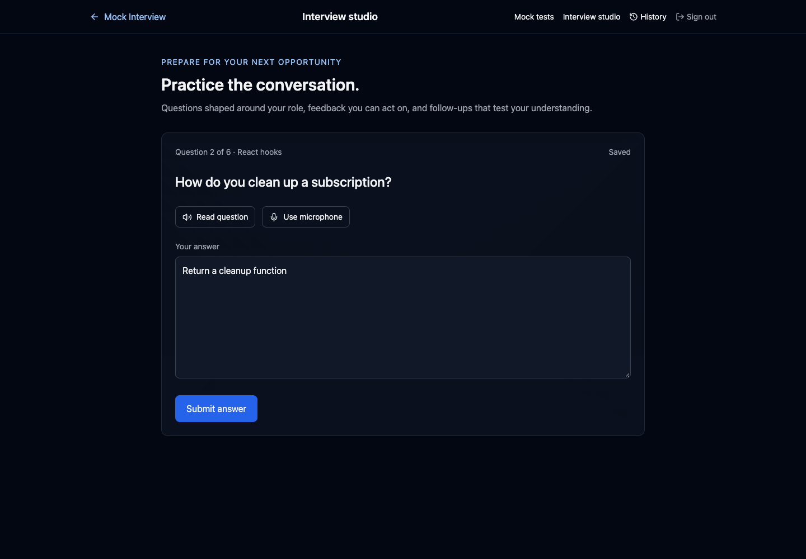
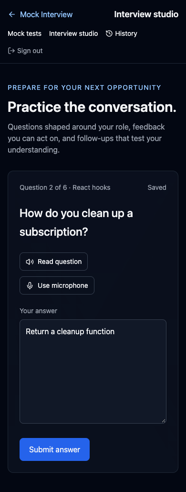
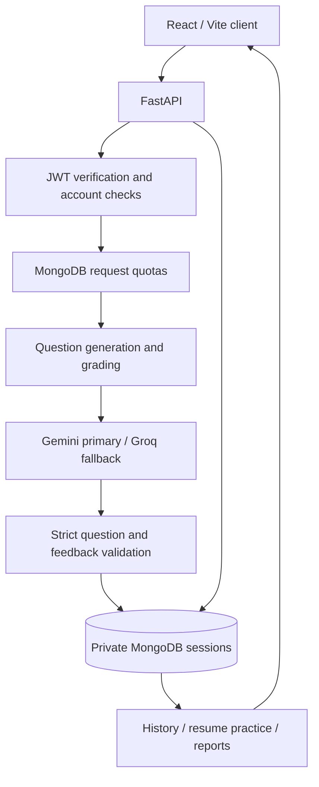

<div align="center">

# Mock Interview AI

**Practice with purpose. Build confidence, one session at a time.**

Resume-aware technical interviews, timed mock tests, saved progress, and actionable AI feedback.

[Live application](https://mock-interview-king-09.vercel.app/) · [GitHub](https://github.com/Priyanshuraj0909/Mock-Interview) · [Development roadmap](docs/development-roadmap.md)

React 19 · Vite · TypeScript · FastAPI · MongoDB · Gemini / Groq

</div>

## What you can do

| Workflow | Implemented behavior |
| --- | --- |
| Mock tests | Choose a subject, difficulty, purpose, test type, and duration. Generate exactly ten validated questions and review graded answers. |
| Personalized interviews | Choose a technical role and difficulty, optionally supply a job description and resume, and generate five questions. |
| Resume upload | Extract text from a PDF or UTF-8 text file, or paste it directly. Files are limited to 2 MB, ten PDF pages, and 20,000 extracted characters. Scanned PDFs without text require pasted text. |
| Adaptive follow-ups | After an answer is evaluated, request a question that probes its misconception or explores a deeper trade-off. Up to three follow-ups per interview, one per original question, before completion. |
| Saved practice | Answers autosave after a short typing pause. Reopen sessions from History, including completed reports. |
| Feedback and study priorities | Review scores, strengths, specific improvement points, and topic-level practice suggestions. |
| Browser voice | Read questions aloud or dictate answers where browser support and microphone access permit. |
| Accounts | Sign up and sign in with password hashes, expiring JWTs, and rotating 30-day refresh cookies. Save a recovery code, reset a forgotten password, or permanently delete your account and practice data. |
| Progress | Compare score history within the same practice type, subject/role, and difficulty. Interview topic priorities use distinct original questions and exclude follow-ups. |
| AI resilience | Bounded Gemini retries, ordered Groq fallback, strict output validation, and recoverable failure messages. |

The interview studio and mock-test screens are accessible after sign-in. AI generation, evaluation, follow-up, and resume extraction requests share a database-backed per-user limit, defaulting to 20 requests per minute. History and autosaves do not consume that quota.

## Version 0.3.0

Adds `/progress` and `/account`, recovery-code password resets, rotating HttpOnly refresh cookies,
account deletion, opt-in structured operational logs, and 36 synthetic grading examples across roles
and difficulty levels. Save a recovery code in Account settings before you need password recovery;
email delivery is not configured. Resetting a password consumes the code and revokes earlier tokens.
Refresh sessions rotate on use and expire after 30 days; signed-out access tokens can remain valid
until their existing expiry. Recovery codes and refresh tokens are stored only as hashes.

Operational metrics are enabled in the Vercel configuration and disabled by default locally.
Logs contain route templates, status, duration, configured provider/model, fallback use, and token
counts where supplied by the provider. They contain no prompts, resume text, answers, cookies,
account IDs, or email addresses. Token counts support cost analysis; no billing estimate is fabricated.

## Interface preview

These are local browser captures with **mocked API responses and demonstration content**, not evidence of live AI accuracy.



<details>
<summary>Mobile preview</summary>



</details>

## Architecture



Questions, reference answers, configuration, answers, evaluations, and results are owned by server-side sessions. The browser receives no reference answer keys before grading. Submission accepts a session ID and answers, then grades against the stored question set.

Each saved session belongs to one account. Answer updates use a revision number to reject stale writes from another tab. Grading uses an expiring lease to prevent overlapping updates; retries return an already saved result instead of evaluating it again. Graded interview answers cannot be edited under an existing evaluation.

The test deadline is saved on the server and displayed after reload. Timer-triggered submission is a client practice convenience; this platform is not a proctored examination system.

## Technology

| Layer | Technology |
| --- | --- |
| Client | React 19, React Router 7, Vite 7 |
| Types | TypeScript for API contracts, draft persistence, reports, and shared components; existing screens remain JSX |
| UI | Tailwind CSS 3, Lucide icons |
| API | Python 3.12 target, FastAPI, Pydantic |
| Persistence | MongoDB, PyMongo Async, timezone-aware timestamps |
| AI | Google GenAI SDK, Groq SDK, shared asynchronous adapter |
| Resume parsing | pypdf, bounded PDF/text extraction |
| Authentication | python-jose JWTs, existing Passlib/bcrypt password hashes |
| Verification | pytest, HTTPX, Vitest, React Testing Library, GitHub Actions |
| Hosting | Existing Vercel React static build and Python function |

## Local development

Use Node.js 22.12+ within the Node 22 release line and Python 3.12. The repository includes `.nvmrc` and `.python-version`.

```bash
git clone https://github.com/Priyanshuraj0909/Mock-Interview.git
cd Mock-Interview
python3 -m venv .venv
source .venv/bin/activate
pip install -r requirements.txt
cp Ai/.env.example Ai/.env
```

Configure a reachable MongoDB instance, a JWT secret of at least 32 characters, and at least one AI provider key in `Ai/.env`. Use only supported model IDs available to your provider account.

```bash
cd Ai
uvicorn main:app --reload --port 8000
```

In another terminal:

```bash
cd newmyapp
npm ci
cp .env.example .env
npm start
```

The Vite client runs at `http://localhost:3000` and proxies `/api` to FastAPI at `http://127.0.0.1:8000`. API documentation is at `http://localhost:8000/docs`.

On Windows, activate the environment with `.venv\Scripts\activate` and use your shell's file-copy command.

## Configuration

| Variable | Purpose / default |
| --- | --- |
| `GEMINI_API_KEY` | Gemini access; configure this or `GROQ_API_KEY` |
| `GROQ_API_KEY` | Groq access and optional fallback |
| `GEMINI_MODEL` | Configurable model ID; code default is `gemini-3.8-flash` |
| `GROQ_MODELS` | Comma-separated ordered model IDs |
| `GROQ_MODEL` | Optional preferred model when `GROQ_MODELS` is unset |
| `MONGODB_URI` | Required for accounts, quotas, and practice persistence |
| `MONGO_URL` | Compatibility alias when `MONGODB_URI` is unset |
| `MONGODB_DB` | Database name; `ai_mock_interview` |
| `JWT_SECRET_KEY` | Required server secret, at least 32 characters |
| `JWT_ALGORITHM` | Symmetric signing algorithm; `HS256` by default |
| `ACCESS_TOKEN_EXPIRE_MINUTES` | Token lifetime; `60` |
| `AI_TELEMETRY_ENABLED` | Opt-in structured operational logs; `false` locally, enabled by `vercel.json` |
| `AI_REQUESTS_PER_MINUTE` | Shared per-user request limit; `20` |
| `CORS_ORIGINS` | Comma-separated browser origins; `http://localhost:3000` |
| `VITE_API_BASE_URL` | Public client API base; `/api` |
| `REACT_APP_API_BASE_URL` | Legacy client setting accepted when the Vite setting is unset |

Server credentials belong only in server environment settings. Client variables are public build-time configuration. The original resume file is not stored; extracted text is saved privately with the interview and sent to the configured AI provider. Browser voice input may use the browser vendor's speech service.

MongoDB holds `users`, `sessions`, `refresh_tokens`, and `rate_limits`. Startup creates the unique user email index, the session owner/time index, and a TTL index for quota buckets. No migration of existing account documents is required; existing bcrypt hashes remain supported.

The repository previously documented a credential in source history. Revoke any such historical credential and keep replacement keys out of Git.

## API

All practice endpoints require `Authorization: Bearer <token>`. Signup, login, and health endpoints are public.

| Method | Endpoint | Purpose |
| --- | --- | --- |
| POST | `/api/auth/signup` | Create an account and issue a JWT |
| POST | `/api/auth/login` | Sign in and issue a JWT |
| POST | `/api/auth/refresh` | Rotate a valid refresh cookie and issue a new access token |
| POST | `/api/auth/logout` | Revoke the current refresh token and clear its cookie |
| POST | `/api/auth/recovery-code` | Create a replacement recovery code after password confirmation |
| POST | `/api/auth/reset-password` | Reset with email and a saved one-time recovery code; revoke prior tokens |
| POST | `/api/auth/delete-account` | Confirm password and delete the account and owned practice data |
| GET | `/api/analytics` | Private score trends and deduplicated topic evidence from up to 100 sessions |
| GET | `/api/test` | API health and release version; does not verify MongoDB or provider access |
| POST | `/api/generate-test` | Generate and save ten questions; return a private session without answer keys |
| POST | `/api/submit-answers` | Grade `{sessionId, answers}` using server-owned questions |
| POST | `/api/interview/generate-questions` | Generate and save five resume/job/role-aware questions |
| POST | `/api/interview/evaluate-answer` | Evaluate `{sessionId, questionId, answer}` and save feedback |
| POST | `/api/interview/follow-up` | Generate a bounded adaptive question for an evaluated answer |
| POST | `/api/resume/extract` | Extract raw `application/pdf` or `text/plain` request content |
| GET | `/api/sessions` | Return up to 30 recent session summaries; optional `limit` from 1–100 |
| GET | `/api/sessions/{sessionId}` | Resume an owned session or retrieve its report |
| PATCH | `/api/sessions/{sessionId}/answers` | Save `{answers, revision}`; return the next revision |
| GET | `/api/interview/health` | Interview router health |

This release changes submission and interview-evaluation contracts. Old clients sending question text or answer keys must update to session IDs. The included frontend uses the new contracts.

Errors include 401 for invalid/expired authentication, 404 for missing or unowned sessions, 409 for conflicting saves or active processing, 422 for invalid input, 429 for quota exhaustion, and 503 for unavailable providers or database operations. Resume uploads also use 413 for oversized files and 415 for unsupported types.

## Grading and AI behavior

Multiple-choice answers use the saved answer key. Blank answers are incorrect. Written and code answers receive meaning-based evaluation that accepts paraphrases and valid alternative implementations. Code is reasoned about by the model; it is **not executed**.

The server validates written-answer verdicts and derives the test score. Interview feedback uses a bounded integer score from 0–10, strengths, and improvement points. Invalid model output returns a recoverable error rather than a fabricated score.

The shared adapter gives Gemini a 15-second request timeout and one retry for handled temporary failures. Groq tries configured models with ten-second attempt timeouts, within a 55-second total call budget. The code's default Groq order is `openai/gpt-oss-20b`, `openai/gpt-oss-120b`, then `qwen/qwen3.8-27b`. These are code defaults, not verified availability guarantees; configure supported model names for your account.

## Verification

```bash
pip install pytest
python -m pytest Ai/tests -q
npm test --prefix newmyapp
npm run build --prefix newmyapp
```

Backend tests cover authentication, ownership isolation, quotas, hidden answer keys, strict generation output, answer conflicts, grading leases and recovery, idempotent submissions, resume validation, semantic report handling, and provider fallback. Frontend tests cover retries, answer preservation, autosave, reload, navigation saves, duplicate generation prevention in StrictMode, feedback field rendering, and follow-ups.

These tests use mocked providers and an in-memory MongoDB substitute. Local browser checks additionally exercised desktop/mobile UI flows with mocked API responses. Real MongoDB connectivity, provider access, and grading accuracy need environment-specific verification. The GitHub Actions workflow checks the Python 3.12 and Node 22 setup on pushes and pull requests.

A small starter grading dataset covers paraphrases, alternative code, misconceptions, and answer prompt injection:

```bash
# Validate the dataset without provider calls:
python Ai/evaluate_grading.py

# Explicit live evaluation, using provider credits:
python Ai/evaluate_grading.py --live --runs 3 --output .eval-results/grading.json
```

Live runs report label agreement and latency, and exit unsuccessfully if any run falls below 90% agreement. The 36 synthetic starter cases are not a comprehensive or independently validated benchmark.

A disposable-account smoke check verifies real MongoDB and authentication after deployment:

```bash
python scripts/verify-release.py --allow-create-account
# Also exercise live provider generation/grading (uses provider credits):
python scripts/verify-release.py --allow-create-account --live-ai
```

The script removes its disposable account and practice data in a cleanup step. It does not report
live grading accuracy; run the dedicated benchmark with configured provider keys for that measurement.

## Vercel deployment

The existing project is hosted under [king-09 / mock-interview](https://vercel.com/king-09/mock-interview). Keep the Vercel root directory at the repository root.

- The root `vercel-build` script installs locked frontend dependencies and builds `newmyapp/build`.
- `vercel.json` routes `/api` to `api/index.py` and other paths to the React application.
- Python dependencies include the PyMongo Async driver and pypdf; no additional hosted service is required for this release.
- Keep MongoDB, AI, JWT, and optional model overrides in Vercel's server environment settings. No new secret is required for the delivered features.
- After deployment, verify `/api/test` reports version `0.3.0`, then check sign-in, generation, autosave/reload, history, and grading.

MongoDB Atlas must permit the hosting environment's outbound connections and use valid credentials. The driver retains certificate verification. A rule for your laptop alone does not permit Vercel connections.

## Next development

See the [roadmap](docs/development-roadmap.md) for live grading evaluations, opt-in AI tracing, richer historical analytics, knowledge retrieval, streaming LiveKit voice, and sandboxed Judge0 coding practice. Streaming voice requires an agent worker; code execution requires a separate execution service. Those integrations are not included in this release.

Current limitations include browser-dependent voice support, local-storage access JWTs, short autosave debounce windows, recovery-code-only password resets, and AI-dependent judgments. Refresh cookies assume same-site hosting; a cross-site API needs an explicit cookie/CSRF design. Cross-session topic evidence is limited to the latest 100 sessions and does not establish skill mastery. Identical normalized questions count once per role/difficulty/topic; semantic duplicates may still count separately. Application account deletion does not control provider retention or hosting backups.

## Contributing and license

Run the relevant tests and build, keep changes focused, and explain behavior and validation in pull requests. Never commit real credentials.

No license is currently declared. No MIT or other open-source license is implied.

Author: [Priyanshu Raj](https://github.com/Priyanshuraj0909)  